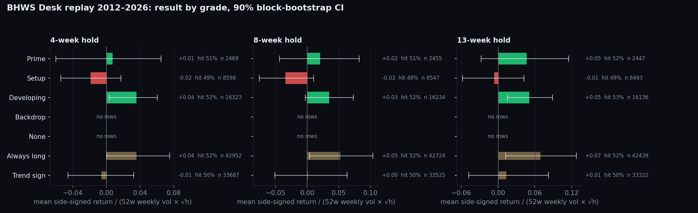
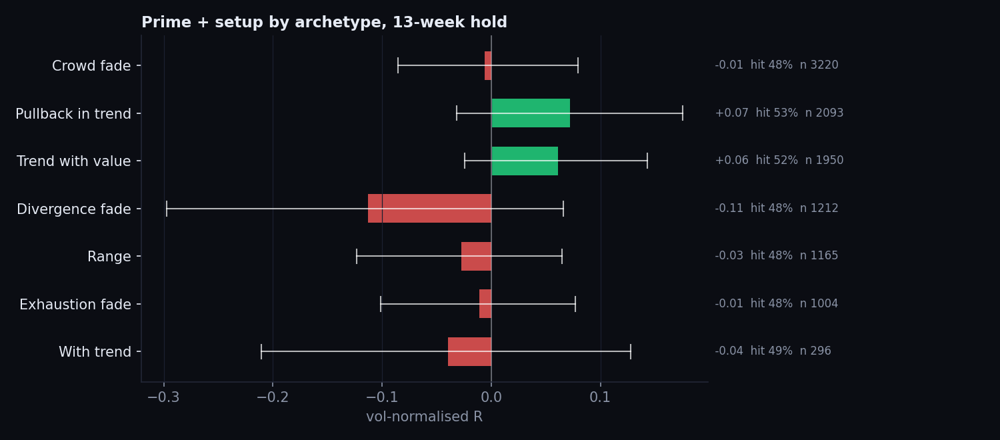
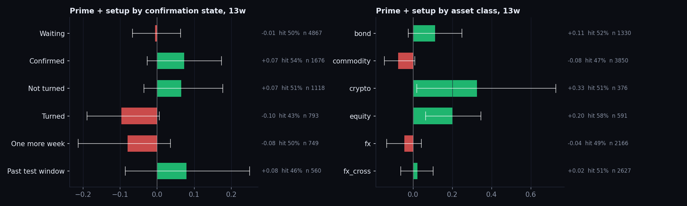
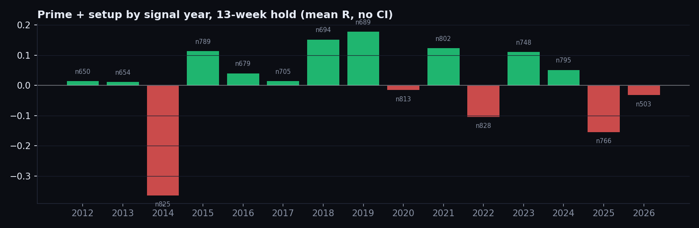

# BHWS Desk replay, 2012 to 2026

Built 28 October 2026. This report tests the Desk rules as they stand. It does not change them. Every number here is in-sample replay evidence for a rule. None of it is a probability for a live trade.

## Method

- Universe: 57 markets (futures continuous contracts, cash indices, FX spot, crypto). Weekly signal dates from 6 January 2012 to 23 October 2026.
- Point in time: each Friday, the Desk grading (archetype, confirmation state, grade, side) is rebuilt only from data available that day. COT uses only rows observed at least three days before the signal Friday (the Tuesday report released that day). Seasonality uses only years before the signal year.
- Entry is the next trading day's close. The exit is the close 4, 8 or 13 weeks later. The headline is 13 weeks.
- Unit: R is the side-signed return divided by (trailing 52-week weekly standard deviation × √h). An R of +0.10 means the move ran a tenth of a normal 13-week move in the trade's favour.
- Ranges are 90% moving-block bootstrap intervals with 13-week blocks, so overlapping holds are not treated as independent.
- "After drift" (Rd) subtracts each market's own average 13-week R over the whole sample. It removes the part of a long result that comes from holding something that went up anyway.
- MFE and MAE are the median best and worst points inside the 13 weeks, in the same volatility units. Skew is MFE / MAE.
- Two variants were run: "fixed", which uses the corrected weekly trend horizons, and "asbuilt", which uses the old daily-bar horizons. They come out almost the same: 13-week prime+setup is +0.006 fixed against +0.008 asbuilt. The horizon fix was a correctness repair, not an edge.

## Headline: the grade is not the edge yet

| 13-week hold | n | Mean R | 90% range | Hit |
|---|---|---|---|---|
| Prime | 2,447 | +0.047 | −0.028 to +0.115 | 52.2% |
| Setup | 8,493 | −0.006 | −0.058 to +0.042 | 48.9% |
| Developing | 16,136 | +0.051 | +0.016 to +0.089 | 53.0% |
| Prime + setup | 10,940 | +0.006 | −0.044 to +0.052 | 49.6% |
| Always long, same weeks | 42,439 | +0.069 | +0.012 to +0.128 | 52.4% |
| Trend sign | 33,322 | +0.013 | −0.048 to +0.082 | 50.2% |

- After drift, prime is −0.020 and prime+setup is −0.010. Being long everything beat the graded book.
- By side, prime longs made +0.10 (range +0.00 to +0.20) and prime shorts made −0.06. Setup shorts made −0.07. Most of the positive prime result is long beta.
- The grade does not sort outcomes. Developing did at least as well as prime, and better than setup. That is the main negative finding. It also means the current alignment score should not be read as a strength-of-edge measure.
- By asset class, equity prime+setup made +0.20 and crypto +0.33 (both mostly beta). Commodities made −0.08 and FX −0.04.
- The bad years were 2014 (−0.36) and 2025 (−0.15). I have not attributed them to a cause.

## Where the edge actually shows up

These results hold in both 2012–18 and 2019–26, and they keep their sign after drift. About 60 cells were tested, so a few of them will pass by chance. These ones are the most consistent, not proven.

| Pattern | n | R | 90% range | 2012–18 / 2019–26 | After drift | Skew |
|---|---|---|---|---|---|---|
| Counter-trend, before the weekly close turns | 3,487 | +0.097 | +0.015 to +0.181 | +0.06 / +0.13 | +0.090 | 1.29 |
| Pullback in trend, after the weekly close turns | 845 | +0.199 | +0.050 to +0.327 | +0.19 / +0.21 | +0.044 | 1.24 |
| Crowd fade, before the managers turn | 2,868 | +0.044 | −0.037 to +0.121 | +0.00 / +0.08 | +0.050 | 1.18 |
| Counter-trend longs | 2,120 | +0.155 | +0.059 to +0.251 | +0.07 / +0.25 | +0.062 | 1.45 |

- Early counter-trend is the cleanest finding. It is positive after drift, positive in both halves, has positive skew, and works across commodities (+0.10). Waiting for the 10-week confirmation turned it to −0.01, so the confirmation step gives the edge away. The Desk currently never grades counter-trend above developing.
- Pullbacks that have turned have the biggest raw number, but nearly all of it is drift (+0.04 after drift). It is a good entry for a market you already want to own. It is not an independent edge.
- In crowd fades, timing is everything. The fade worked before the managers turned and failed after it (below).

## What the replay says to stop doing

| Pattern | n | R | 90% range | Halves | After drift |
|---|---|---|---|---|---|
| Divergence-fade shorts | 680 | −0.269 | −0.456 to −0.090 | −0.20 / −0.32 | −0.102 |
| Crowd fade after the managers turned | 1,445 | −0.068 | −0.140 to +0.013 | −0.06 / −0.08 | −0.082 |
| Prime or setup with the seasonal against | 2,674 | −0.120 | −0.206 to −0.032 | −0.05 / −0.18 | −0.049 |
| With-trend shorts | 836 | −0.114 | −0.233 to −0.003 | −0.13 / −0.10 | −0.067 |
| Trend exhausted against the side | 2,889 | −0.088 | −0.206 to +0.040 | −0.04 / −0.13 | −0.031 |
| Exhaustion fade graded prime | 72 | −0.185 | −0.352 to −0.023 | −0.20 / −0.18 | n/a |

- Divergence-fade shorts have the worst payoff shape in the set: the typical run against (0.75) is far bigger than the run in favour (0.47).
- Seasonal against is the strongest single veto for prime and setup rows. After drift it shrinks to −0.05, so part of it is the long-drift effect again, but it never turns positive.
- One surprise: prime and setup rows with positioning against the side made +0.17 (n 520, both halves positive). After drift, that falls to +0.02, so it is mostly drift. Even so, the positioning pillar does not work as a veto in this sample.

## Payoff asymmetry

The Desk edge lab plots median favourable run against median adverse run for every archetype and side. The patterns that hold up above are also the ones with skew above 1.2: early counter-trend at 1.29, counter-trend longs at 1.45 and turned pullbacks at 1.24. The fades that fail sit below the even line, with divergence shorts at 0.63 and late crowd fades at 0.82. This describes the shape of past outcomes. It is not an expectancy for a live R:R.

## Recommended rule changes, for your call

None of these are applied. They are fitted on the same sample they were found in, so they need your sign-off and ideally a forward check.

1. Promote early counter-trend. Allow it to reach setup before the weekly close turns, and stop requiring the 10-week confirmation for it.
2. Stop treating the managers' turn as confirmation for crowd fades. If anything, the turn should end the setup window.
3. Veto divergence-fade shorts, or at least cap them at developing.
4. Make seasonal-against a hard veto for prime and setup. Today it is only a minus in the alignment count.
5. Leave the grade weighting alone until one of the above is tested out of sample. Re-weighting the existing score on this data would be curve fitting.

## What is in the Desk now

- Each market read has a replay edge check card. It shows the closest replay match (archetype and confirmation state, then archetype and side, then archetype), with its R, 90% range, both halves, the after-drift line, an adverse vs favourable run bar, and any veto flags (seasonal against, trend exhausted, fade after the turn).
- Chips on the prime board and setups list read "Replay supports", "Mostly market drift", "Supported, but flagged", "No replay edge" or "Replay negative". "Supports" requires a range above zero, both halves positive, and more than +0.02 after drift.
- The home view has an edge lab section with six findings, an archetype × state heatmap with this week's tickers placed in their cell, the asymmetry scatter, and the grade record against the baselines.

## Caveats

- Data: yfinance continuous futures have roll gaps, cash indices exclude dividends, and FX is spot without carry. No costs or slippage.
- The macro pillar is excluded from the replay because there is no point-in-time macro history, and there is no event gating. The live Desk uses both.
- The engine trend state is approximated in the replay. The composite engine's own momentum sub-scores still use the daily-bar horizon labels, which were left unchanged so the composite stays comparable.
- The seasonal blend defaults and archetype thresholds were set by hand on overlapping history, so even the "fixed" replay is not fully out of sample.
- Roughly 60 cells were tested. At 90% intervals, about six would clear zero by chance alone. The findings above are the ones that hold in both halves and after drift, which is a stricter test, but it is still not a forward test.
- No weights were fitted, and no grade or rule was changed because of this replay.
